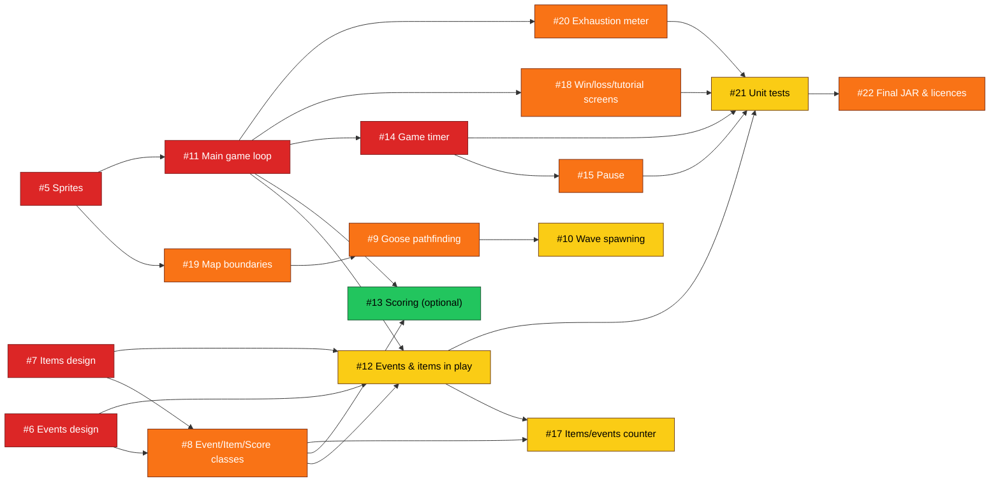

# Escape-the-Geese

A [libGDX](https://libgdx.com/) project generated with [gdx-liftoff](https://github.com/libgdx/gdx-liftoff).

This project was generated with a template including simple application launchers and a main class extending `GooseGame` that sets the first screen.

## Platforms

- `core`: Main module with the application logic shared by all platforms.
- `lwjgl3`: Primary desktop platform using LWJGL3; was called 'desktop' in older docs.

## Gradle

This project uses [Gradle](https://gradle.org/) to manage dependencies.
The Gradle wrapper was included, so you can run Gradle tasks using `gradlew.bat` or `./gradlew` commands.
Useful Gradle tasks and flags:

- `--continue`: when using this flag, errors will not stop the tasks from running.
- `--daemon`: thanks to this flag, Gradle daemon will be used to run chosen tasks.
- `--offline`: when using this flag, cached dependency archives will be used.
- `--refresh-dependencies`: this flag forces validation of all dependencies. Useful for snapshot versions.
- `build`: builds sources and archives of every project.
- `cleanEclipse`: removes Eclipse project data.
- `cleanIdea`: removes IntelliJ project data.
- `clean`: removes `build` folders, which store compiled classes and built archives.
- `eclipse`: generates Eclipse project data.
- `idea`: generates IntelliJ project data.
- `lwjgl3:jar`: builds application's runnable jar, which can be found at `lwjgl3/build/libs`.
- `lwjgl3:run`: starts the application.
- `test`: runs unit tests (if any).

Note that most tasks that are not specific to a single project can be run with `name:` prefix, where the `name` should be replaced with the ID of a specific project.
For example, `core:clean` removes `build` folder only from the `core` project.

## Project board

# Tasks
- fill in methods and attributes of classes: Event, Item and Score (use UML diagrams as a guideline)
- design the player, goose and map images so we can display them in the first screen
- work on the geese' pathfinding
- work on the spawning of waves of geese
- design the different events
- design the different items
- fill in the main game loop with the functionality, adding class methods, attributes and functions where appropriate
- update this list if new tasks pop up
- if you want to take up a task put your name next to it (preferred) or message on the groupchat

## Milestones

| Milestone | Due | Goal |
|---|---|---|
| **M1 – Foundations** | Mon 9 Nov | Sprites on screen; events and items designed; Event, Item and Score classes written |
| **M2 – Core Gameplay** | Thu 12 Nov | Map collisions, geese pathfinding and waves, main game loop, timer and pause |
| **M3 – Content & Integration** | Sat 14 Nov | Events and items in play, HUD counters, screens, exhaustion meter, tests, final JAR, report |
| *Buffer* | Sun 15 Nov | Bug fixing and submission prep |

## Priority labels

| Label | Meaning |
|---|---|
| `P0-critical` | On the critical path: other issues can't start until it's done. Start immediately |
| `P1-high` | Needed for the milestone, and blocks at least one later issue or the submission |
| `P2-medium` | Needed, but nothing else depends on it |
| `P3-low` | Optional or housekeeping |

---

## Dependency map

An arrow from A to B means **A blocks B**: B can't be finished until A is done.



**Colour key:** red = P0, orange = P1, yellow = P2, green = P3.

Not shown because they have no dependencies: **#16 Backlog** and **#23 Report sections and website**, which runs alongside everything else.

### Critical path

```
#5 Sprites → #11 Main game loop → #14 Timer / #12 Events & items → #21 Unit tests → #22 Final JAR
```

If anything on this path slips, the submission slips. Pick these up first and ask for help early if one gets stuck.

---
## Suggested work order

1. **Start now, in parallel:** #5 sprites, #6 events design, #7 items design. Nothing blocks them.
2. **Once the sprites exist:** #11 main game loop and #19 map boundaries.
3. **Once the designs are agreed:** #8 Event, Item and Score classes.
4. **Once the game loop runs:** #14 timer, then #15 pause; #18 screens; #20 exhaustion meter.
5. **Once the map has boundaries:** #9 pathfinding, then #10 waves.
6. **Once the classes and game loop are done:** #12 events and items in play, then #17 counter.
7. **Last:** #21 unit tests, then #22 final JAR. Finish #23 after code freeze so the report matches the code.

## Branches

`main` always holds working code. Nobody pushes to it directly; all changes go through a pull request.

Each issue gets its own branch, named `<issue number>-<short name>`. **Create the branch when you start the issue, not before**, using **Create a branch** under *Development* in the issue's sidebar. This links the branch to the issue on the project board.

| Branch | Issue |
|---|---|
| `5-sprites` | #5 Design player, goose and map sprites |
| `6-events-design` | #6 Design the different events |
| `7-items-design` | #7 Design the different items |
| `8-event-item-score-classes` | #8 Implement Event, Item and Score classes from UML |
| `9-goose-pathfinding` | #9 Goose pathfinding |
| `10-wave-spawning` | #10 Wave spawning of geese |
| `11-main-game-loop` | #11 Main game loop |
| `12-events-items-integration` | #12 Integrate events and items into gameplay |
| `13-scoring` | #13 Connect scoring (optional for A1) |
| `14-game-timer` | #14 Game timer (5 minutes) |
| `15-pause` | #15 Pause and start paused |
| `17-counter` | #17 Items-used and events-found counter |
| `18-screens` | #18 Win, loss and tutorial screens |
| `19-map-boundaries` | #19 Map boundaries and collisions |
| `20-exhaustion-meter` | #20 Exhaustion meter |
| `21-unit-tests` | #21 Unit tests |
| `22-final-jar` | #22 Final JAR and asset licence log |
| `23-report-website` | #23 Report sections and website |

#16 (Backlog) has no branch, as it doesn't change any files.

### Workflow

1. **Start:** check the issue's *Blocked by* list is done, assign yourself, then create the branch.
2. **Work:** commit often with clear messages, for example `Add countdown to GameState (#14)`.
3. **Stay up to date:** if `main` changes, run `git pull origin main` on your branch to bring the changes in.
4. **Finish:** open a pull request into `main` with `Closes #<issue number>` in the description.
5. **Review:** at least one teammate checks it runs before it's merged.
6. **Clean up:** delete the branch after merging. The issue closes and moves to *Done* automatically.

**New task?** Create an issue first, then a branch using the same naming format.
